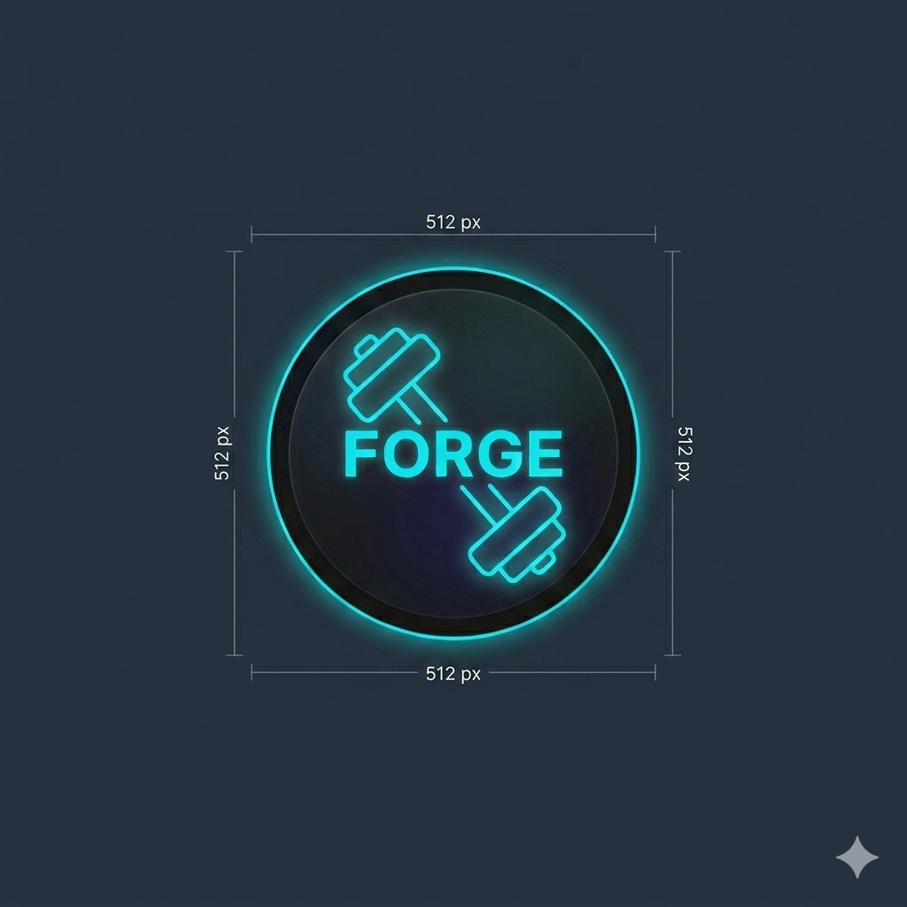
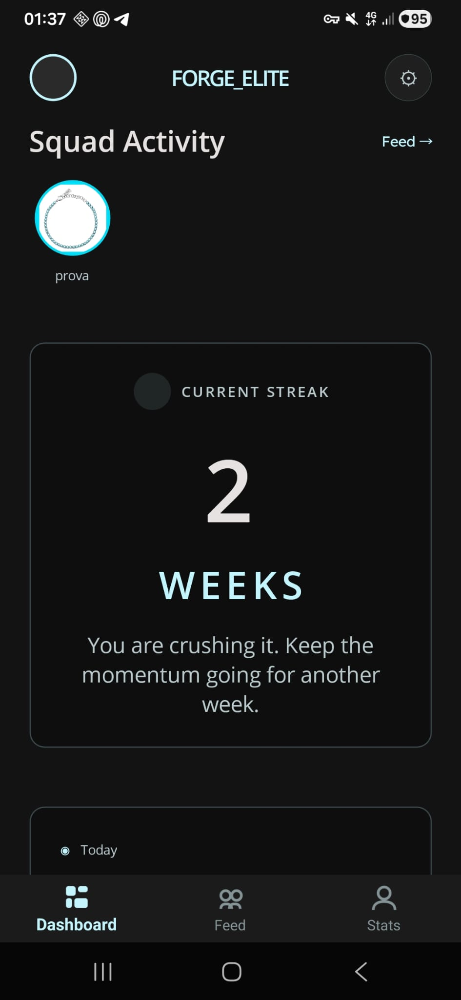
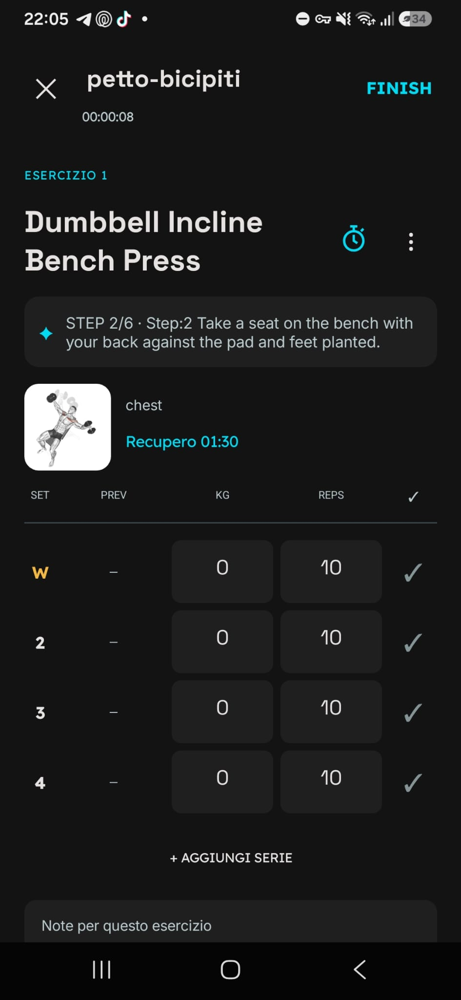
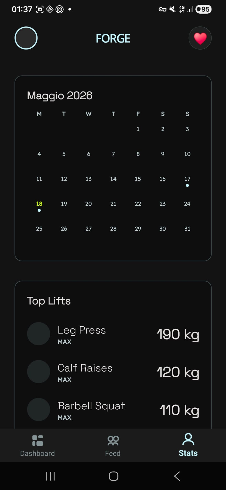
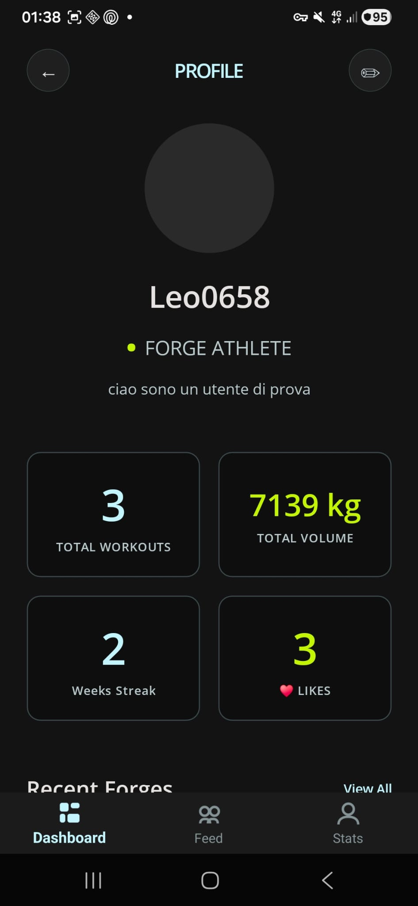
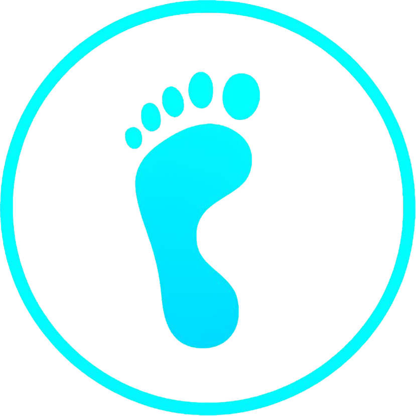
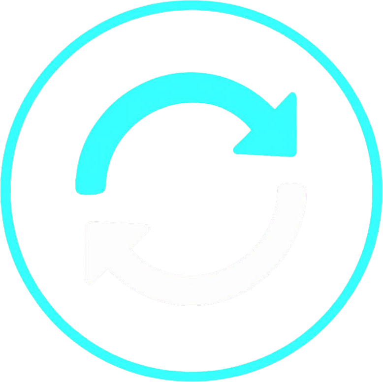
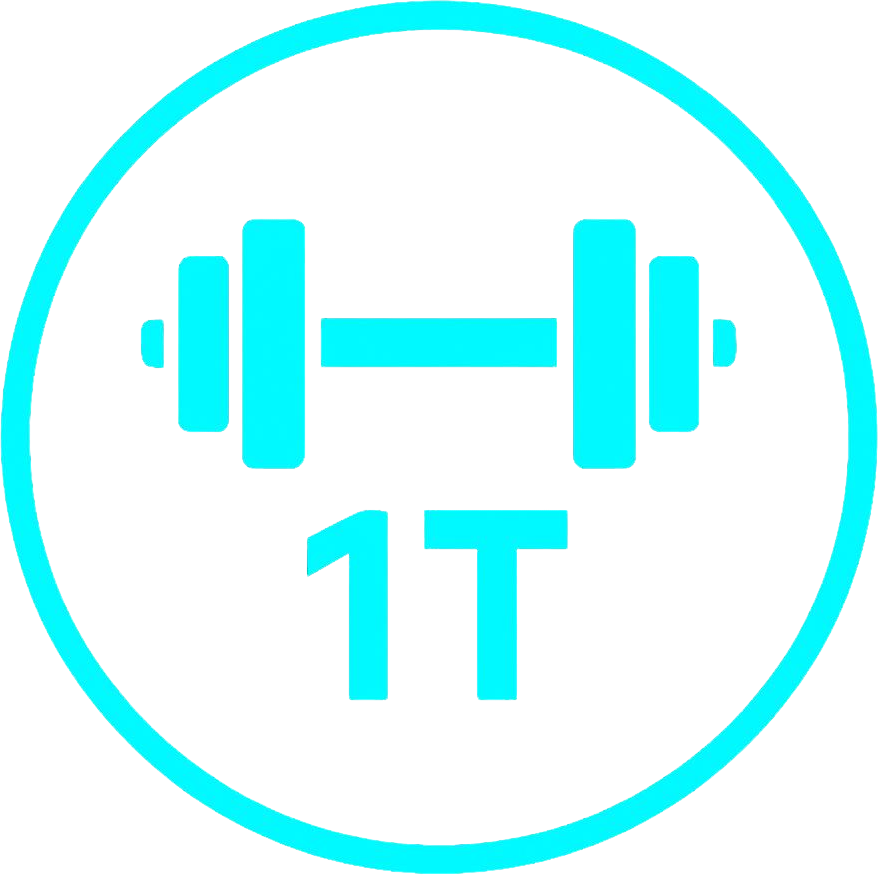

<p align="center"></p>

# FORGE

**Allenati, traccia i progressi e condividili nella tua community.**

Diario di allenamento Android open source: schede personali, timer, statistiche e achievement, con un backend che puoi usare sul server FORGE oppure ospitare tu.

[](https://leonardo-lalli.github.io/FORGE/#download)
[](https://github.com/Leonardo-Lalli/FORGE/releases/tag/v0.8.5-beta)
[](LICENSE)

[Scarica l’app](https://leonardo-lalli.github.io/FORGE/#download) · [Sito](https://leonardo-lalli.github.io/FORGE/) · [Self-hosting](#installa-il-tuo-server) · [Roadmap](ROADMAP.md) · [Segnala un problema](https://github.com/Leonardo-Lalli/FORGE/issues)

## Per il tuo allenamento

- **Le tue schede:** senza un limite imposto dall’app, oppure una sessione libera; serie normali, warm-up, drop set e cedimento.
- **Ritrova il punto di partenza:** carichi e ripetizioni precedenti, note automatiche degli esercizi già presenti nella scheda.
- **Segui la sessione:** recupero per esercizio da 0 a 5 minuti, notifica del timer e consigli di esecuzione che cambiano a carosello.
- **Guarda i progressi:** storico, foto, volume, calendario e progressione per esercizio.
- **Condividi con chi vuoi:** profili, follow e like tra utenti dello stesso server, con visibilità pubblica, privata o per amici reciproci.
- **Rendi visibili i traguardi:** achievement retroattivi supportati dallo storico, livello e badge nel profilo.

Due temi, chiaro e scuro. Il catalogo offre istruzioni e URL GIF dove disponibili; completezza e disponibilità dei media dipendono dai dati e dal provider.

## Dentro l’app

L’allenamento è una foto recente fornita dal proprietario. Le altre schermate provengono dall’archivio di sviluppo e possono differire dall’interfaccia attuale. Sul sito le icone delle notifiche sono coperte nella visualizzazione; il file originale resta invariato.

<p>
  
  
  
  
</p>

## Inizia a usare FORGE

1. Scarica l’APK dalle [release](https://github.com/Leonardo-Lalli/FORGE/releases) o dal [sito](https://leonardo-lalli.github.io/FORGE/#download), e installalo su Android 6.0 o successivo.
2. Crea un account: il server FORGE predefinito è già selezionato. Non devi installare un server per provare l’app.
3. Personalizza una scheda oppure inizia un allenamento libero.

Se hai un backend tuo, inserisci il suo URL nelle impostazioni e crea un account su quella istanza. Ogni server ha la propria community: **gli utenti di istanze diverse non si vedono**. Amici significa due persone che si ricambiano il follow.

**Beta 0.8.5:** disponibile per le prove, con limiti dichiarati e feedback benvenuti. Il codice su `main` può includere correzioni successive: un push non aggiorna automaticamente l’APK del tag. Il server pubblico è gestito a casa del proprietario e non ha disponibilità garantita.

<details>
<summary>Hai una vecchia build? Leggi prima di reinstallare</summary>

**Passaggio dalle vecchie build:** la 0.8.0 pubblicata e gli APK di prova usavano certificati Debug diversi. La 0.8.5 avvia la firma stabile di release; Android può richiedere una reinstallazione. **Il CSV è un riepilogo, non un backup completo:** non conserva schede, foto né i dettagli reali delle serie e dei carichi. Prima di disinstallare verifica la sincronizzazione degli allenamenti e conserva separatamente schede, note e foto (ad esempio trascrivendole o acquisendo schermate). Gli allenamenti già sincronizzati restano sul server.


Gli aggiornamenti direttamente dall’app non sono ancora implementati.

</details>

## Achievement e gamification

Gli achievement rendono visibili la costanza e i progressi senza richiedere di ricominciare da zero: quelli valutabili dallo storico si sbloccano **retroattivamente**, anche per allenamenti completati in precedenza sull’account corrente.

- **Costanza:** primo allenamento, allenamenti totali e frequenza mensile.
- **Volume e durata:** traguardi di volume per sessione/settimana/mese e ore di allenamento.
- **Varietà e foto:** esercizi diversi provati e foto aggiunte agli allenamenti.
- **Profilo:** scegli quali badge sbloccati mostrare e consulta il tuo livello.

Il livello usa **100 XP per achievement sbloccato** e aumenta ogni **500 XP**. Riaprire la schermata non assegna XP aggiuntivi. Gli XP rappresentano i badge, non una misura della forma fisica.

Alcune voci del catalogo richiedono criteri non ancora implementati, ad esempio classifiche e sfide: non promettiamo che tutti i badge siano già sbloccabili. Medaglie per i record delle singole serie restano un’idea futura, come richiesto durante lo sviluppo. Non ci sono classifiche globali tra server.

<p>
  
  
  
</p>

## Installa il tuo server

**Docker, LXC e Proxmox hanno percorsi distinti.** Docker avvia i servizi in container; LXC installa il backend dentro un container esistente; il percorso Proxmox crea un nuovo LXC dal nodo. Gli installer sono di FORGE, non ancora del catalogo ufficiale Community Scripts.

L’avvio guidato chiede una versione numerica di PocketBase >= 0.23.0, l’email amministrativa e una password unica. Può generare una password casuale e conserva la configurazione nel file privato `.env`. Clona il progetto e richiama l’installer che configura PocketBase, collezioni, hook e quattro migrazioni, con backup.

### Docker — Linux o WSL

Richiede Docker Engine e Docker Compose già installati, con accesso root/sudo per backup e migrazioni. Esegui sul server Docker:

```bash
bash -c "$(curl -fsSL https://raw.githubusercontent.com/Leonardo-Lalli/FORGE/main/tools/install.sh)" -- docker
```

### LXC — dentro il container

Per un nuovo container Debian/Ubuntu con systemd. Esegui **come root dentro il CT**, non sul nodo Proxmox:

```bash
bash -c "$(curl -fsSL https://raw.githubusercontent.com/Leonardo-Lalli/FORGE/main/tools/install.sh)" -- lxc
```

### Proxmox VE — dal nodo

Esegui **come root nella shell del nodo Proxmox**. Crea un nuovo LXC, seleziona Debian/Ubuntu e installa FORGE. Storage e bridge sono `local-lvm` e `vmbr0` per default, personalizzabili con `FORGE_CT_STORAGE` e `FORGE_CT_BRIDGE`. Per scegliere il sistema senza il menu usa `FORGE_CT_OS=1` (Debian) o `FORGE_CT_OS=2` (Ubuntu):

```bash
bash -c "$(curl -fsSL https://raw.githubusercontent.com/Leonardo-Lalli/FORGE/main/tools/install.sh)" -- proxmox
```

Questi comandi scaricano ed eseguono [lo script guidato](tools/install.sh) da `main`; puoi anche leggere il sorgente e avviarlo da un checkout. Sono per **nuove installazioni**: il bootstrap non sovrascrive una directory esistente e non aggiorna un CT PocketBase già configurato. La configurazione rimane privata in `~/forge-server/.env` salvo percorso personalizzato; conserva un backup protetto.

Docker pubblica la 8090 su loopback per default. Il dominio HTTPS/reverse proxy e le push Firebase richiedono configurazione separata: il setup non apre porte del router né modifica Nginx. I percorsi guidati sono verificati staticamente; **la prova completa Docker/LXC è ancora necessaria**, senza promettere installazione universale o tempi fissi.

[Guida completa, aggiornamenti e backup](docs/self-hosting.md) · [Push facoltative](docs/push-notifications.md) · [Installer Docker](tools/community-install.sh) · [Installer LXC](tools/proxmox-install.sh) · [Creazione CT](tools/proxmox-create.sh)

### Obiettivo: Proxmox Community Scripts

Vogliamo rendere FORGE semplice da installare anche per la community Proxmox. Gli script nel repository sono la base: il prossimo passo è adattarli alla struttura `ct/forge.sh` e `install/forge-install.sh`, verificarli su un’istanza Proxmox reale e proporli nel repository DevScripts per revisione. **FORGE non è ancora integrato ufficialmente.**

Le [linee guida del progetto](https://github.com/community-scripts/ProxmoxVE/blob/main/CONTRIBUTING.md) prevedono per nuovi script il passaggio dal repository di sviluppo e dalla revisione dei maintainer. Non confondere l’installer FORGE con l’attuale script Community Scripts che installa soltanto PocketBase.

## Dati, privacy e limiti

| Dati / funzione | Comportamento attuale |
| --- | --- |
| Schede | SQLite sul telefono, associate all’account; non promettiamo sincronizzazione delle schede tra dispositivi |
| Allenamenti | Salvataggio locale e sincronizzazione PocketBase; bozze locali |
| Social e profili | Dati dell’istanza collegata; privacy applicata dal backend aggiornato |
| Catalogo | ExerciseDB OSS con cache locale/condivisa di metadati, istruzioni e URL dei media |
| GIF | File ospitati dal provider; conservarne l’URL non garantisce disponibilità offline |
| Push social | Client Firebase FCM e worker disponibili; richiedono configurazione e prova di consegna |
| Timer | Notifica locale Android, indipendente dal worker social |

Lo snapshot del server riportato dal proprietario il 12 ottobre 2026 contiene **2.305 record, 1.325 nomi distinti, 1.500 record con URL GIF e istruzioni e 805 senza**. Sono conteggi del database, non una garanzia di 2.305 esercizi unici o di file GIF tutti raggiungibili. Vedi [catalogo e limiti](docs/exercise-catalog.md).

La modalità completamente locale senza account/server è **solo una proposta**. Non confonderla con la persistenza locale già presente. FCM e i media esterni introducono dipendenze di terze parti; self-hosting non significa automaticamente assenza di connessioni esterne.

Le regole di privacy e la cancellazione account dipendono da un backend FORGE con le migrazioni aggiornate. Il timer locale è distinto dalle push social: client FCM e worker sono disponibili, ma la consegna con app chiusa resta da verificare. [Stato e verifiche della beta](docs/release-readiness.md).

## FORGE per le palestre

Una community per chi si allena nella stessa struttura è la direzione del progetto. La beta offre già schede personali e social sullo stesso server; dashboard trainer, assegnazione schede e gestione di più palestre sono ancora obiettivi futuri. [Visione B2B](https://leonardo-lalli.github.io/FORGE/b2b).

## Origine del progetto

FORGE è nato come progetto studentesco di informatica di **Leonardo Lalli**, ed è cresciuto con prove sul telefono e in palestra e feedback degli utenti. Lo sviluppo usa estesamente l’AI, incluso Codex, per codice, interfacce, revisione e documentazione. L’AI è uno strumento: la responsabilità delle scelte e delle release resta del proprietario; prove e limiti sono documentati.

## Sviluppo

Stack: .NET 10 MAUI, MVVM con CommunityToolkit.Mvvm, PocketBase, SQLite, ExerciseDB OSS, Firebase FCM facoltativo; sito Next.js esportato su GitHub Pages.

```bash
dotnet workload install maui-android
dotnet restore src/Forge/Forge.csproj -p:TargetFramework=net10.0-android
dotnet build src/Forge/Forge.csproj -f net10.0-android
dotnet test tests/Forge.Tests/Forge.Tests.csproj
```

Usa SDK Android/JDK compatibili con il workload. Per FCM Android configura `google-services.json` per `com.leoforge.forge` seguendo la guida push; non è la chiave Firebase Admin. Per una distribuzione pubblica serve una chiave di firma di produzione stabile. L’APK locale di verifica è distinto dalla release di produzione.

Struttura: `src/Forge` app, `tests/Forge.Tests` regressioni, `tools` installazione/backend, `sitoGithub` sito, `docs` specifiche e verifiche. Documentazione: [architettura](docs/architecture.md), [matrice verifiche](docs/test-matrix.md), [preparazione beta](docs/release-readiness.md), [roadmap](ROADMAP.md).

## Confronto con altre app

Il vantaggio di FORGE oggi è **scegliere e modificare il proprio backend, creare una community separata e usare schede senza limite applicativo o abbonamento nell’app**. Non affermiamo superiorità generale per affidabilità, integrazioni o facilità d’installazione.

Hevy limita la versione gratuita a quattro routine; Strong a tre template. FORGE non impone questi limiti. Hevy offre però un social più articolato e Strong integrazioni e strumenti già consolidati. wger è già open source e self-hosted: non siamo unici in questo e wger copre anche alimentazione e misure. Fonti ufficiali e confronto dettagliato in [app simili](docs/comparison.md), verificato il 13 ottobre 2026.

## Contribuire e segnalare problemi

Apri una [issue](https://github.com/Leonardo-Lalli/FORGE/issues) indicando versione APK, modello del telefono, versione Android, passaggi per riprodurre il problema e comportamento atteso. Non includere credenziali, token, dati personali di altri utenti o chiavi server. Contributi piccoli e verificabili sono benvenuti; segnala anche limiti della documentazione.

## Licenza e attribuzioni

Il codice FORGE è distribuito con [licenza MIT](LICENSE). Catalogo, GIF, font e altre risorse di terze parti conservano le proprie licenze: la MIT del repository non concede automaticamente diritti su quei contenuti. Il provider attualmente usato è [ExerciseDB OSS](https://oss.exercisedb.dev/), non wger. Prima di distribuire cataloghi/media o offrire un servizio commerciale, verifica le condizioni dei contenuti scelti.
